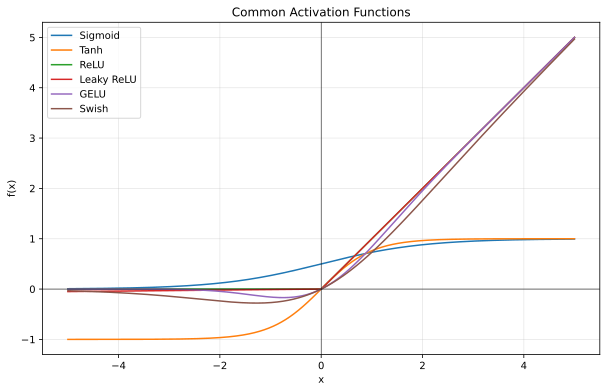
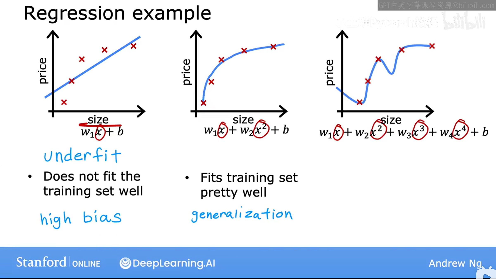

# 笔记

---

## 入门笔记


### 人工智能、机器学习与深度学习之间有什么关系？
- 人工智能包含机器学习，机器学习包含深度学习。
- 定义
1. 人工智能：让机器表现出类似人类的智能行为，分为弱人工智能（只能完成特定任务）、强人工智能、通用人工智能AGI（能处理各种任务）、超人工智能
2. 机器学习 AI 的一个子领域，核心是让机器从数据中自动学习规律，而不是人写死规则；可以抽象成，让函数去拟合一条弯曲的特征曲线（但不是拟合地越好效果就越好）。AI的回答是**机器学习是在限定的假设空间中，通过优化损失函数，寻找一个既能拟合数据、又能泛化的映射函数。**
3. 深度学习 用多层神经网络从数据中自动学习层次化的特征表示，并端到端地完成预测、分类、生成或决策等任务。
[参考视频 | 吴恩达机器学习](https://www.bilibili.com/video/BV1owrpYKEtP/?p=36&share_source=copy_web&vd_source=f39c1f30d2954fc0785b71603f8726ee)

### 监督学习和无监督学习有什么区别？请各举一个例子。
- 监督学习：给定模型输入x和对应的标准答案y，让模型去拟合其中的映射关系，特点是每个样本都有标签。例如预测房价，给定房子的面积、离商圈的距离等，然后给房子的价格（y），可以用随机森林之类的解决。
- 无监督学习：只给模型数据x，模型需要自己发现数据的结构或模式。用于聚类等任务。例如电商用户分类，自动地根据用户的年龄、消费等级进行分类。
- 需要注意的是分类问题，分类问题属于监督学习，样本的类别就是标签y，容易把分类问题判断成无监督学习了，**类别是预先定义好的**。

<a id="data-feature-label"></a>
### 数据、特征和标签分别是什么？训练集、验证集和测试集各有什么用途？
- 数据：从输入层输入，经过神经网络后，从输出层输出pred，把这个输出pred与标签y求损失，用于反向传播更新参数（每个batch，反向传播一次）
- 特征：特征是样本的属性，每个样本可以有多个特征。对单个样本，如果它表示一维张量，张量的每一个维度就是一个特征，$x_1$、$x_2$、$x_3$之类的，在python中就是x = [x1, x2, x3, ...]  [|张量笔记--戳我跳转|](#tensor)
- 标签：在train函数中用于损失函数，标签y与模型预测pred经过损失函数计算后，在反向传播中起到更新参数的作用，在val和test中用于评估模型精度
- 训练集：训练模型，更新参数到合适的大小
- 验证集：作用在每个epoch后，用于评估这一轮训练的成果，一般用来保存精度最高的模型
- 测试集：评估最终训练好的模型的能力

<a id="batchsize"></a>
### batch size是什么？有什么影响？
[Dataset、Dataloader--戳我跳转](#datasetdataloader)
通俗来说BatchSize是Dataloader的一个参数（我通常这样理解，但是AI告诉我说，batchsize是一个超参数，这点在下面会谈到），用于设置每次传入的数据。
假设训练集共有1280个数据，设置batchsize为64，则一轮epoch中，模型要传入20次数据，抽象来说就是把货物分几次装箱
**不过**，batchsize的深层影响，不只是简单的分批次传数据的作用，而是根据BatchSize与样本数N的大小关系，可分为以下几种参数更新频率：
- B == 1：随机梯度下降SGD，每次只用一个样本更新
- 1 \< B \< N：mini-batch梯度下降，最常用的一种，每次用一小批样本梯度下降
- B == N：全批量梯度下降BGD，每次使用所有样本梯度下降
**BatchSize不是Dataloader的独有属性**：Dataloader只是方便我们配合Dataset传数据的一个函数，实际上我们也可以自己写循环来训练模型，这时候就需要自己定义BatchSize了，例如
```python
batch_size = 64
for i in range(0, len(X), batch_size):
    batch_x = X[i:i+batch_size]
    batch_y = y[i:i+batch_size]
    ...
```

==额外的一点：batchsize越大，越吃硬件性能，而且可能训练会变慢==

### 什么是模型和模型参数？
- 模型：一个从输入到输出的映射规则，模型=架构+参数
- 模型参数：与超参数不同（训练开始前人为设定的、不变的，比如说epoch、BatchSize），模型参数是给定一个初始值，然后在训练过程中不断更新。例如线性回归的w矩阵和b。可以说模型的优化就是模型参数的更新，训练结果保存也是通过保存模型参数为.pth等格式来实现。

### 神经网络由哪些基本部分组成？什么是激活函数？为什么要激活函数？请介绍几种常见的激活函数。
- 神经网络组成：输入层、隐藏层（做y=wx+b的线性变换，w和x可以为矩阵，**每个隐藏层后加激活函数**）、输出层
- 激活函数：作用在神经元线性输出之后的非线性函数。作用是：如果只有神经元去线性拟合，那模型无法拟合复杂曲线，加上激活函数之后可以为模型增加非线性，方便拟合复杂曲线。
- 激活函数举例：
1. 当前最常用的ReLU：$\mathrm{ReLU}(x)=\max(0,x)$
2. Sigmoid：$\sigma(x)=\frac{1}{1+e^{-x}}$
3. Tanh：$\tanh(x)=\frac{e^x-e^{-x}}{e^x+e^{-x}}$
4. Leaky ReLU：$\mathrm{LeakyReLU}(x)=
\begin{cases}
x, & x>0 \\
\alpha x, & x\le 0
\end{cases}$
5. GELU：$\mathrm{GELU}(x)=x\Phi(x)$
6. Swish：$\mathrm{Swish}(x)=x\sigma(x)$
<center>下面是python+matplotlib绘制的常见激活函数的图像：</center>


### 矩阵如何求导？提前学习该部分数学。
- 矩阵：这里说的矩阵应该是权重矩阵吧？在Pytorch的约定下，矩阵每一行代表同一个神经元对不同特征的w，每一列代表同一特征对不同神经元的w
- 矩阵求导：对于复杂的矩阵，核心是利用链式求导法则，对矩阵中的每个元素w分别求偏导，然后放回原位置。

### 怎么用矩阵乘法表示神经网络的全连接层前向传播过程？
全连接层的前向传播=输入（矩阵） x 权重（矩阵） + 偏置（数组）

### 前向传播与反向传播分别在做什么？损失函数、梯度和学习率在训练过程中扮演什么角色？
- 前向传播：把输入x，通过神经网络得到一个输出output，output与acc计算（先通过max转化成pred）、反向传播相关
- 反向传播：根据预测值pred和标签y，用损失函数Loss计算损失L，然后利用链式求导法则计算每个模型参数对L的影响程度（也就是梯度），然后根据【梯度乘以学习率$\alpha$】的大小更新每个参数
- 损失函数：计算模型输出的损失，配合链式法则，计算每个模型参数相对于损失L的梯度
- 梯度：相当于每个模型参数对损失L的贡献，计算好梯度之后可以对不同模型参数做出不同方向、大小的调整，方便模型优化
- 学习率：调整整体参数的步长，梯度决定下降的方向，学习率决定下降多少
<center><mark>梯度决定方向和大小，学习率把梯度整体缩放</mark></center>

### 优化器是什么？有哪些？
- 定义：利用梯度来更新模型参数的工具
```python
optimizer.zero_grad()   # 1. 清空旧梯度
loss.backward()         # 2. 反向传播，计算新梯度
optimizer.step()        # 3. 用梯度更新参数
```
- 常见：
1. 基础：SGD（随机梯度下降）、Momentum（加入动量的SGD，减少震荡、加速收敛）
2. 自适应学习率：Adam（最常用）、AdamW、Adagrad

### 什么是过拟合，欠拟合，正则化？
- 过拟合：模型死记硬背，在训练集表现非常好，在测试集表现很差
- 欠拟合：模型完全没学好，训练集和测试集表现都很差

<p align="center" style="font-size: 10px">*第三种就是过拟合*</p>
- 正则化：为了抑制过拟合现象，在损失L后面加上一个惩罚项：
1. L1正则化：加上权重绝对值的和
2. L2正则化：加上权重平方和
3. 在网络架构中加入Dropout：随机失活一定比例的神经元

---

## 自我探索
### AI的实现方式
- 传统：规则系统、专家系统、搜索、逻辑推理
- 机器学习：从数据中学习，如 SVM（二分类任务）、决策树（ID3， C4.5，CART）、随机森林
- 深度学习：用神经网络，如 CNN、Transformer、大语言模型
- 强化学习：通过与环境交互和奖励学习策略，如 AlphaGo
<a id="tensor"></a>
### 张量Tensor
类似于多维数组，但是和数组有区别：张量可以放到GPU上运算、张量能自动求导（例如输入一张图像的[C, H, W]就是一个张量，其中C是通道数，H是高，W是宽）
[戳我回去](#data-feature-label)

<a id="datasetdataloader"></a>
### Dataset|Dataloader
这两个都是比较好用的工具，来自torch.utils.data库
- Dataset：传入参数有data_root和transforms，即数据地址和数据增强操作，配合torchvision.transforms.Compose([])使用
- Dataloader：传入Dataset，定义batchsize，还可以设置是否打乱顺序

[戳我回去](#batchsize)

### 数据预处理
数据处理是机器学习实操中比较困难的一部分，因为得到的数据千奇百怪，需要写脚本做大量清洗与转换等操作。常见的处理操作有：
数据清洗、数值特征变换、类别特征处理、特征工程、数据增强等
- 数据清洗：缺失值、异常值处理、去重、噪声处理、统一格式
- 数值特征变换：归一化等
- 类别特征处理：标签编码（文字类别转标签类别）、独热编码（转成只有一个1的向量）、有序编码（用顺序编码）、目标编码（用标签统计量编码）
- 特征工程：特征交叉（组合多个特征）、多项式特征（增加非线性项，例如$x,x^2,x^3$）、统计特征（均值、方差这种）、时间特征、文本特征、图像特征
- 数据增强：依靠数据类型有不同增强方式。
1.  图像：翻转、旋转、裁剪、缩放，加噪声、模糊、遮挡
2. 文本：同义词替换，随机插入/删除/交换
3. 音频：加噪声，加速、变调

### 梯度消失、下降
#### 梯度消失
1. 定义：在反向传播时，梯度呈指数级衰减，靠近输入层的参数几乎得不到有效的更新。
2. 影响：靠近输入层得权重几乎无法更新，相当于网络只训练了最后几层全连接层，而前几层卷积层处于随机状态。模型退化为浅层网络，无法提取高阶抽象特征。
#### 梯度爆炸
1. 定义：在反向传播时，梯度呈指数级增长，导致靠近输入层得梯度变得很大，模型无法收敛。
2. 影响：导致参数瞬间变成极大值，激活函数输出进入饱和区，或直接超出浮点数表示范围，Loss变为NaN，训练中断。
3. 产生原因：两者的核心数学原因都是一个简单的连乘不等式：假设每层回传时梯度都要乘以一个因子λ，经过n层后，梯度值正比于λ<sup>n</sup>，当λ<1时梯度消失，当λ>1时梯度爆炸。（这里简化了，实际上是不同w连乘造成）

### 决策树
决策树是机器学习中的一种监督算法，每一个内部节点选择一个特征和分裂条件来分支。常见的决策树有ID3，C4.5，CART，决策树不同命名核心上是划分准则不同，当然树结构和一些值的处理方式可能也有点不同
- 信息熵：$$Entropy(D) = -\sum_{i=1}^{n}p_i\log_2 p_i$$信息熵高代表不确定性大
- 信息增益：$$Gain(D, a) = Entropy(D) - \sum_{v=1}^{V} \frac{|D^v|}{|D|} \cdot Entropy(D^v)$$它量化了使用某一个特征对原始数据集进行划分后，整个数据集的不确定性能下降多少
- 信息增益比：$$\operatorname{GainRatio}(D,a)=\frac{\operatorname{Gain}(D,a)}{\operatorname{SplitInfo}(a)}$$信息增益比 = 信息增益 / 分裂信息
<span style="font-size: 10px; color:#888;">这些公式看着很复杂，用多了应该就比较熟练了</span>

<p align="center" style="font-size: 25px"> 常见决策树 </p>

- ID3：在每个节点上，选择信息增益最大的特征作为当前节点的划分特征。有两个缺点：1.倾向于选择取值较多的属性，有些情况下这些属性反而可能不会提供太多有价值的信息；2.ID3算法只能对描述属性为离散型属性的数据集构造决策树
- C4.5：解决了ID3算法两个大问题，是ID3算法的改进；从使用信息增益来选择属性划分，变成了使用信息增益比最大的那个
- CART：采用Gini系数最小化作为特征选择的准则：$Gini(D) = 1 - \sum_{i=1}^{n} p_i^2$

[参考视频-ID3](https://www.bilibili.com/video/BV1JvpZeyE3Z/?share_source=copy_web&vd_source=f39c1f30d2954fc0785b71603f8726ee)
[参考视频-C4.5](https://www.bilibili.com/video/BV1VA411A7AQ/?share_source=copy_web&vd_source=f39c1f30d2954fc0785b71603f8726ee)
[参考视频CART](https://www.bilibili.com/video/BV1EFnfe6EJ3/?share_source=copy_web&vd_source=f39c1f30d2954fc0785b71603f8726ee)

### 注意力机制
#### 注意力机制
- 核心思想：|  **动态权重分配**  |  就是聚焦到当前图片或语句最重要的部分
*模型在处理序列数据时，不再将输入信息压缩成一个固定长度的向量，而是允许每个输出位置动态地去关注输入序列中所有位置，并根据当前任务需求，为不同位置分配不同的重要性权重，最终将加权汇总后的信息作为当前步骤的输入依据。*
- 相比于RNN/LSTM的显著优势：
1. RNN的信息需沿着时间逐层传递，距离越远，梯度越容易消失，注意力机制任意两个位置之间的信息传递长度均为1（一步就能到）；
2. RNN具有顺序依赖性，后面的步骤必须等前面进行完了才能进行，而注意力机制高度并行化、充分利用硬件、加速训练；
3. RNN的向量是固定的，难以应对长句中的一词多义或复杂语法，而注意力机制每个词的表征都融入了整个句子所有词的加权信息，能根据上下文动态调整语义。
- 注意力机制打破了序列模型必须按时间顺序处理的限制：解决了传统模型的顺序依赖性和长距离失忆。
#### 自注意力机制
[学习视频](https://www.bilibili.com/video/BV16f1mB7Ebj/?spm_id_from=333.1387.favlist.content.click&vd_source=2d9cc4fb5733e923eee8f59b3bd569d5)
- 与注意力机制的区别：注意力机制的Q和K/V不同源，而自注意力机制的Q、K、V同源
- 含义：
1. Q：查询Query
2. K：键Key
3. V：值Value
一句话可以拆分成多个词元（Token），例如”小明喜欢吃苹果“可以拆分成“小明” “喜欢” “吃” “苹果”四个词元，每个词元都可以用一个多维向量来表示，这句话中所有词元的向量维度相同，这些向量可以组成一个矩阵，把这个矩阵分别与W_Q，W_K，W_V矩阵（这些矩阵的长宽取决于输入矩阵）相乘得到Q、K和V

然后通过Q和K的相关联程度（Q点乘K的转置）算出分数，分数越高相关程度越高
将分数除以$\sqrt{d_k}$，避免梯度消失

对每一行用Softmax函数，将分数变成概率权重

将权重乘V得到自注意力输出，总的来说就是
$$\text{Attention}(Q, K, V) = \text{softmax}\left( \frac{Q K^T}{\sqrt{d_k}} \right) V$$

还可以使用多头注意力机制，让模型从不同角度分析一个句子。

### 贝尔曼方程
简单了解了一下，公式有点复杂，但是实际应用到例子中还是比较好掌握的。
总回报 = 即时奖励 + $\lambda$ x 未来回报

- 矩阵表达 

<mark style="background:#dc2626; color:#fef2f2; padding:2px 4px; border-radius:3px;">贝尔曼期望方程（固定策略π，线性形式）</mark>

状态动作价值迭代形式：
$$\boldsymbol{Q}^\pi = \boldsymbol{R} + \gamma \boldsymbol{P}^\pi \boldsymbol{Q}^\pi$$

闭式解析解：
$$\boldsymbol{Q}^\pi = \left( \boldsymbol{I} - \gamma \boldsymbol{P}^\pi \right)^{-1} \boldsymbol{R}$$

状态价值版本：
$$V^\pi = R^\pi + \gamma P^\pi V^\pi$$

<mark style="background:#dc2626; color:#fef2f2; padding:2px 4px; border-radius:3px;"> 贝尔曼最优方程（非线性形式）</mark>

状态价值最优形式：
$$V^{*}(s) = \max_{a} \left[ R(s,a) + \gamma \sum_{s'} P(s' | s,a) V^{*}(s') \right]$$

动作价值最优形式：
$$\boldsymbol{Q}^*(s,a) = \mathbb{E}_{s' \sim P(\cdot|s,a)} \left[ R(s,a,s') + \gamma \max_{a'} Q^*(s',a') \right]$$

- 价值优化逻辑 根据上面的状态价值最优形式公式，逻辑是寻找当前动作a，使得当前奖励加上下一状态的折后价值之和最大，是一个全局最优解问题。
- 策略迭代、值迭代数学原理理解：
1. 策略迭代：随机选定一个初始策略$\pi_0$，针对当前策略$\pi$，迭代求解所有状态的对应值函数$V_\pi(s)$，直到值函数完全收敛。基于收敛后的$V_\pi(s)$，对每个状态重新选择能最大化期望回报的动作，得到新的更优策略$\pi'$。重复执行，直到策略不再发生变化，测试得到最优策略$\pi^*$。
2. 值迭代：将所有状态的初始值设为0或任意初始值。每一轮迭代中，直接对每个状态应用贝尔曼最优方程更新值：$$V(s) = \max_{a} \left[ R(s,a) + \gamma \sum_{s'} P(s'|s,a) V(s') \right]$$
其中R(s,a)是即时奖励，$\gamma$是折扣因子，P(s'|s,a)是状态转移概率。
当所有状态的最大数值变化小于预设阈值时，停止迭代。基于收敛后的最优值函数，对每个状态选择能最大化后续期望回报的动作，直接得到最优策略。

应用：强化学习、动态规划


---