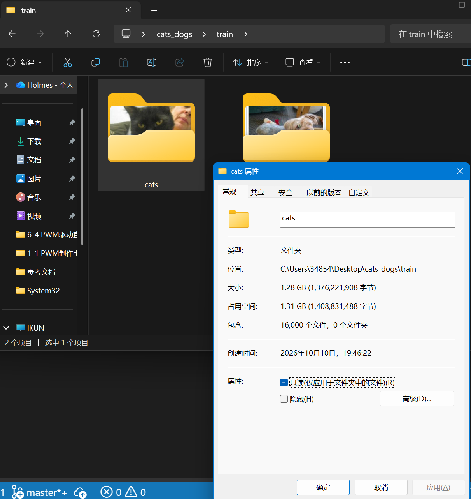
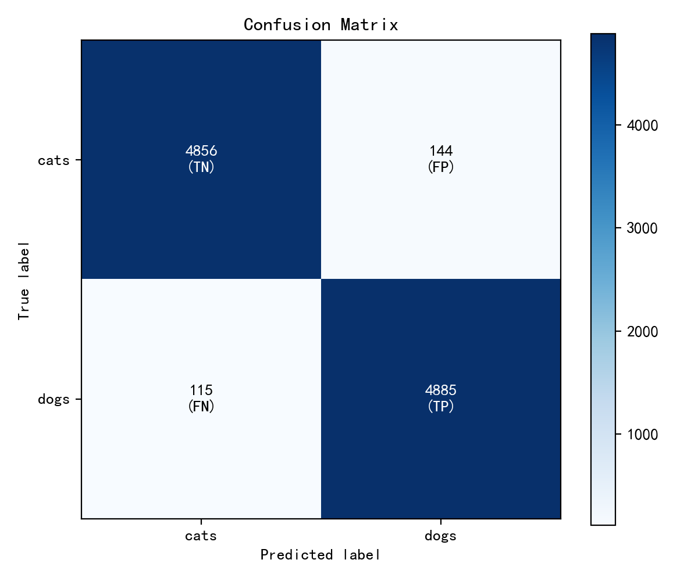

# 实验笔记
## 任务部分
[./make_moons训练模型.ipynb](./make_moons训练模型.ipynb)
1. 激活函数的选择：ReLU，默认的首选，计算简单又快、缓解梯度消失
2. 损失函数的选择：选择CrossEntropyLoss交叉熵损失，它内部包含LogSoftmaax，避免手动Softmax导致的数值不稳定；三分类也可以用CrossEntropyLoss，或者NLLLoss+手动LogSoftmax
```python
model = nn.Sequential(
    nn.Linear(2, 64),
    nn.ReLU(),
    nn.Linear(64, 3),
    nn.LogSoftmax(dim=1)
)

loss_fn = nn.NLLLoss()
```
3. 三个函数完成的工作：
- optimizer.zero_grad()：清空模型参数的旧梯度
- loss.backward()：从Loss出发，反向传播，计算每个参数对损失的梯度，把每个梯度存到param.grad
- optimizer.step()：根据梯度更新参数
4. 网络深度、宽度的影响：更深更宽的网络效果不一定更好，首先这种网络的参数量巨大，训练缓慢，且极易造成过拟合现象，其次容易梯度爆炸/消失。然后简单也不好，容易欠拟合。
5. 学习率的影响：学习率过大，容易在最小值点附近来回震荡；学习率过小，梯度下降非常缓慢，耗时非常久。从图像上看，学习率大的在loss收敛后，loss曲线可能又往上走了，即loss又增加了。
6. 样本数量不均衡训练出来的模型：因为某一类别的数量就那么几个，模型很难确认是不是这个类别的，所以很大概率会把本来是这个类别的判为另一类别。因为图片占一定内存，所以实验就在本地跑了，在后面有展示。
7. 导致过拟合的操作：设置很多epoch，然后不加dropout，不加正则化，不设置early stopping，用很宽的模型，数据直接拿来用、不进行数据增强等。判断过拟合就是loss曲线降到低后又上升，然后test_loss曲线和train_loss曲线之间有明显的、很宽的间隙（acc曲线类似的）
8. 加深理解的网站：很直观啊🤩，提供了数据集、学习率、激活函数、正则化、噪声、batchsize这么多选项，还可以自定义网络结构
9. **控制变量实验**：
- 把noise从**0.01**调整为**0.1**，月亮变粗糙了一点，然后训练还是很轻松，在第三轮epoch就基本收敛且loss接近于0，混淆矩阵中的FP从0变成1，TN从0变成2；再调整为**0.3**，loss收敛于0.23左右，并且test_acc和train_acc能看出来有差别了，相差了大概0.1的精度
- 保持noise为0.1不变，增加两层隐藏层（原始为两层）：
```python
self.net = nn.Sequential(
            nn.Linear(2, 64),
            nn.ReLU(),
            nn.Linear(64, 64),
            nn.ReLU(),
            nn.Linear(64, 128),
            nn.ReLU(),
            nn.Linear(128, 64),
            nn.ReLU(),
            nn.Linear(64, 2)
        )
```
混淆矩阵相差不大，比较明显的不同就是test的loss和acc曲线在收敛之后出现了明显的波动，很轻微的过拟合现象。

---

## 实验
数据展示：自己找了16000张猫，4000张狗
<p style="font-size: 10px">代码跟make_moons差不多，只不过要用transform.Compose进行数据处理。</p>

**实现过程**：就简单跑了12个epoch（还挺久的😴，不过最终acc有0.97左右），保存了最佳模型参数到.pth文件，然后写了一个val函数来进行测试，用了一个额外的val数据集（猫狗各5000张）来检验成果。
**结果**：
可以看到狗被错误识别成猫比猫被错误识别成狗的次数多，说明模型有倾向于猫的趋势

---


## 心得部分
1. 首先是编辑器的选择，我选择在jupyter lab中开发。由于之前一直用的Pycharm是一个强大的轮椅编辑器，一直按tab都能把代码写好，只需要手动做出微调。这导致在用jupyter写代码的时候记不全名称，大小写很痛苦，一直要查资料，这一点是我的缺陷，以后要做出改进。
2. 一开始noise设置的是0.01，原始数据散点图看起来就像两条弯弯的线一样，训练效果也是非常的好，所以后面改了一下noise做对比实验
3. 上手画图有点难度，期间调用了很多次AI来解决，我还是边用边学吧😅