# 猫狗分类-task2
---
## 实践1-卷积核
实验1代码在[./卷积核-实践1.ipynb](./卷积核-实践1.ipynb)
#### 1. 像素是什么？什么是RGB？灰度图和彩色图有什么区别？
- 像素是图像的最小单元，可以理解成一张图片被切成无数个小方格，每个小方格就是一个像素
- RGB分别代表红绿蓝三种颜色，每个像素用三个数字代表三种颜色的亮度，uint8格式的数字范围是[0, 255]，float32是[0.0, 1.0]
- 灰度图中，每个像素只有一个数字，代表灰度，0是纯黑，255（或1.0）是纯白
#### 2. 代码见"./卷积核-实践1.ipynb"。
- 数值表示什么：H -> Height，即图片的高度；W -> Width，即图片的宽度；C -> Channels，即图片的通道数，三通道常见的就是RGB图，灰度图是单通道
- 区别：就是HWC的位置不同，一般使用transpose(2, 0, 1)把数据从numpy数组转化到tensor，使用to_tensor这种内置了transpose，所以不用手动调动了
#### 3. 卷积是什么？怎样移动？每到一个位置进行的计算？
-  学习视频：[发展与应用](https://www.bilibili.com/video/BV1X3Kh6oE5U/?share_source=copy_web&vd_source=f39c1f30d2954fc0785b71603f8726ee) ；[CNN原理：卷积层、池化层、全连接层](https://www.bilibili.com/video/BV1AL4y1b7er/?spm_id_from=333.337.search-card.all.click&vd_source=2d9cc4fb5733e923eee8f59b3bd569d5) ；[入门视频集](https://www.bilibili.com/video/BV1gqRjBeEuQ/?spm_id_from=333.788.videopod.episodes&vd_source=2d9cc4fb5733e923eee8f59b3bd569d5)
- 卷积核：一个在图像上滑动的窗口，我们可以通过kernel_size参数来设置卷积核的大小，假设设为3，就生成了一个3*3的卷积核（正方形的，共占9个像素点）。
- 移动的过程：首先设置padding来填充图像的四周（这一步主要是方便改变输出图片的尺寸），然后设置stride来调整卷积核移动的步长；**以卷积核的最左最上的那一个像素为参考点**，每次卷积核与它框住的部分做完卷积之后，就向右移动stride那么长的像素点，如果碰到右侧边界了，就向下移动stride长度的像素点，又从最左边开始卷积，直到卷积到不能再向下移动stride那么长。
- 怎么运算的：对应像素点的数值相乘，再把整体的加起来得到一个新数值，放在输出的对应位置
- 池化：池化层在卷积层后，移动和卷积层差不多，但是滑动窗口不像卷积核那样有数值，每一块的输出是选择窗口中的最大值或平均值
#### 4. 手搓卷积核：
自己造一个卷积函数，心里居然升起了别样的情愫🫢。详见[./手搓卷积函数.ipynb](./手搓卷积函数.ipynb)。实践过程中，我发现有些卷积后输出的图像人类无法读懂，然后卷积核的和加起来等于一的话就和原图没啥区别--->但是可以实现模糊和锐化的操作（原来是这样实现的）

#### 5. 使用不同卷积核处理图片
代码同样放在与4相同的文件[./手搓卷积函数.ipynb](./手搓卷积函数.ipynb)中了
#### 6. 为什么均值与高斯卷积会让图片变模糊？为什么锐化会让边缘更明显？Sobel 卷积核为什么能找到边缘？
- 均值与高斯卷积：**均值**卷积核会让中心像素变成它与四周像素数值的均值，如果中心比四周数值大，那中心数值就会减小，中心突然被抹平，看起来就像模糊了一样；**高斯**卷积与均值卷积类似，只不过在输出均值中，中心的影响最大（中心的权重最大，远离中心权重减小，权重和为1）。**均值模糊更糊，高斯模糊更平滑**
- 锐化：锐化核，中心为正数，四周填充负数，所以中间比四周亮的时候，卷积会让它更亮，中间比四周暗的时候，卷积会让它更暗
- 边缘检测：
以x方向的核为例：
-1 0 1
-2 0 2
-1 0 1
左右的正负数在运算后能反映左右的亮度差异，而边缘的定义就是亮度突然变化的地方，边缘特征图看起来就像拓印一样。
#### 7. 记录卷积核大小、padding、stride 与输出尺寸之间的关系
输出尺寸 = ⌊输入尺寸 + 2*padding - kernel_size⌋ / 步长 + 1
<small>⌊⋅⌋就是向下取整</small>
#### 8. 图像卷积完成后，部分结果可能小于 0 或大于原来的像素范围。保存图片以前想一想应该怎样处理这些数值
先clip到[0, 255]，再进行astype(np.uint8)的类型转换

---

## 实践2-训练猫狗分类器
1. 下载数据集：数据集较大没有上传，**复现**可直接使用[download_data.py](./Cats_Dogs_task/download_data_1.py)下载到cats_and_dogs文件夹中（会自动创建文件夹、解压、展平目录、删除无用文件、自动分类）（前提是系统的.kaggle文件夹里放好了API才能下载）。通过[picture.py](./Cats_Dogs_task/picture_2.py)，发现猫有12500张，狗有12500张，其中随机各抽了4张图片，尺寸、清晰度、背景都有所差异，运行程序即可查看。还有就是它的test1集没有分猫和狗，应该是为了比赛用的，所以我没有管这个文件夹了，train集用的是cat.0.jpg这类格式，我先在这个文件夹中分成了cat和dog两个文件夹，在之后的处理中把train分成了train和val，8:2
2. 数据处理见[data_processor.py](./Cats_Dogs_task/data_processor_3.py)，运行后的图片都是224*224的正方形（先随机裁剪80%~100%再缩放的），batchsize为32
3. 网络定义见[net.py](./Cats_Dogs_task/net_4.py)
4. 代码复现见[net.py](./Cats_Dogs_task/net_4.py)中的main函数。批次（**N**）一直为1，只与我传入的batch有关；通道数**C**好像与out_channels有关，in_channels只能设置为输入通道数，不然会报错；因为我的数据处理后的图片是正方形，所以我们只看高H（W和H一直相等），好像只有池化对它有影响，因为Conv2d、BatchNorm2d、ReLU过后这个值都没变，所以应该是池化减小了图片尺寸，浓缩了一下信息
5. 代码戳[可视化特征提取.ipynb](./Cats_Dogs_task/可视化特征提取_5.ipynb)   
第一层还能看出一点点轮廓，最后一层已经抽象成像素块了，输出的特征图不同，应该是由于关注的特征不同，所以模型能从多视角看图片。
6. 代码戳[数据增强对照试验.ipynb](./Cats_Dogs_task/数据增强对照试验_6.ipynb)   
可能破坏标签：对于猫狗分类来说，垂直翻转、大角度旋转、裁剪范围太小；可能图片失真：过强锐化、太多噪声、用错mean/std
7. 查看预测错误的函数装在[train.ipynb](./cats_dogs_task/train.ipynb)中了，训练结束（共20个epoch，并且保存了模型文件，然后输出了loss等的折线图，有点轻微的过拟合）后才调用的这个函数来检查，相当于val。一共输出了16张错误的照片（上限设为16张），预测出错应该是 **轮廓不常见或不明显、有部分遮挡或特征没照进去、宠物在图片中占比小**等导致的。就我看，导致出错的特征：一张图有多只狗；狗和环境融为一体了；狗只露了不到半张脸（有的只露了耳朵和身体，有的露了脸、但是没露耳朵也是错的）；狗以一种奇怪的姿势出现（例如把脸埋在被子里躺着）；狗太黑了（它的脸连人都看不清，更别说分类器了，[2, 4]）；宠物主人的脸占了图片70%以上[3, 4]；两只宠物以一种奇特的方式黏在一起[4, 2]，导致轮廓很奇怪。我原本以为模型预测错误的原因是一种玄学，很难用语言去解释，直到我看到了这种输出图片（预测错误的原因很明显了）：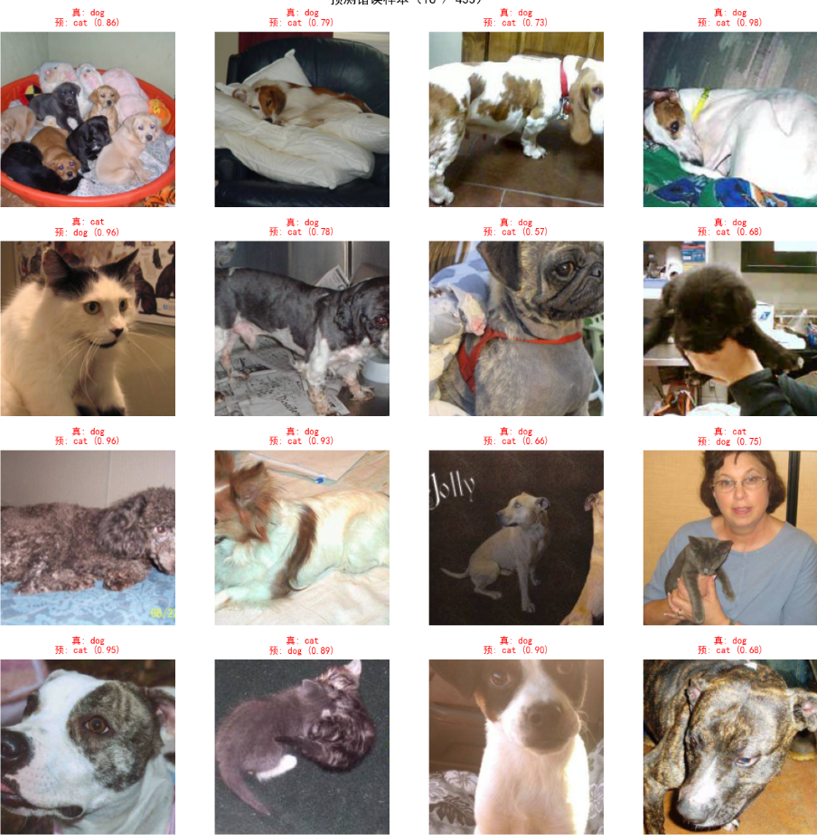
8. 代码戳[分类器](./cats_dogs_task/predictor_8.py)   
可以通过config.yaml文件设置模型参数的路径、图片来源（单张图或文件夹都行）、预测图片的张数（默认一张，大于一张时从文件夹中随机抽）
9. 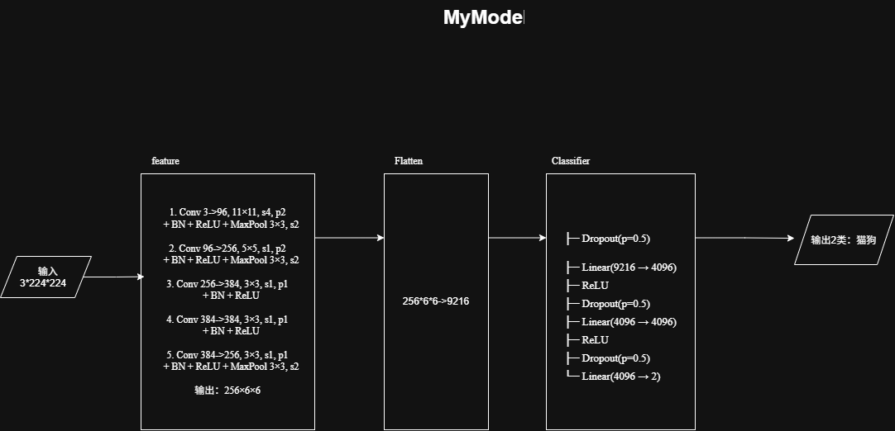   
文件路径："./attachment/MyModel.png"
<center><small><small>删数据集的时候不小心给整个task2项目删掉了，还好有git😄，不过只找回了部分内容，因为有几个文件没来的及add🥹🥹🥹，写了好久的注释也没了🥹</small></small></center>

---

## 趁热打铁部分
- 直接使用一个巨大的全连接层：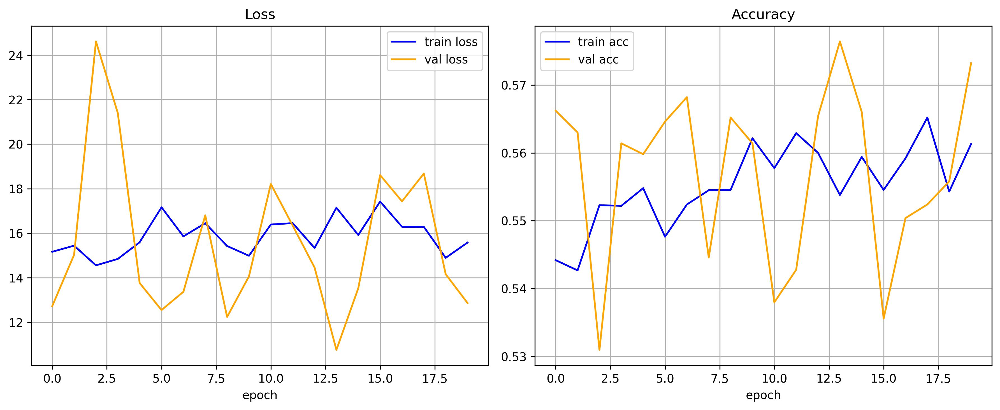可以看到效果基本等于没训练，模型几乎在瞎猜。卷积层能提取图片的局部相关性，而全连接层只是单纯地把具有二维空间结构的图片展为一个很长的向量，会导致参数爆炸、难训练、易过拟合。而使用正常操作得到的训练结果是这样的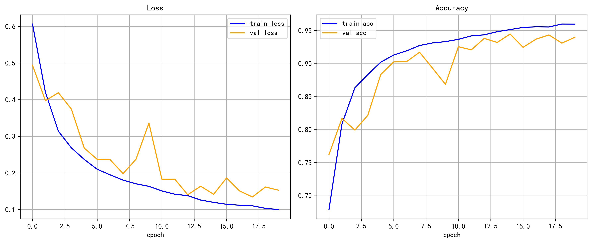
- 输入通道是根据上一层输出通道数来定义的，如果是第一层的输入通道，就是图片的通道，RGB之类的；输出通道数表示这一层产生了多少张特征图。**输入通道数决定卷积核的深度，输出通道数决定卷积核的个数**
- 输出高 = （输入高 + 2*padding - kernel_size）//Stride + 1   
例如网络中的第一层：   
```python
nn.Conv2d(3, 96, kernel_size=11, stride=4, padding=2)
```    
输出高 = (224 + 2*2 - 11) // 4 + 1 = 55   
所以输出的尺寸是96\*55\*55
- 网络越深，通道数越来越多：越往后面，网络在浅层提取到的特征越多，所以需要一个类似放大镜的东西，去放大图片，然后挖掘深层特征，这时就不需要关注一大部分图片了，而是只取一小部分慢慢品尝，所以空间尺寸通常会缩小；而深层特征往往由浅层特征组合而来，组合千奇百怪，所以通道数增多也是自然而然的事了
- 我选择了Adam和CrossEntropyLoss。这是一对经典的搭档，其中交叉熵训练稳定，输出的是模型属于正类的概率（类似于软标签），然后对错误的惩罚大，还自带softmax；然后Adam拥有自适应学习率，收敛快、训练容易
- 因为训练集的数据增强就是为了训练模型用的，增强模型的泛化能力。用在验证集和测试集上的话，模型错误率可能提高。就像人类学汉字一样，从各个方向，各种颜色，各种字体，偏旁部首，来记住这个字，真正遇到的时候没必要再去对它做变化了，直接看还准确一点。然后的话对验证集、测试集做数据增强，不方便结果复现。
1. 翻转：减弱模型对位置偏置的敏感
2. 裁剪；增强平移不变性、尺度不变性和部分遮挡鲁棒性，增加样本多样性，让模型不过度依赖固定位置或全局背景。
3. 颜色：提升对光照、相机、白平衡、设备差异的鲁棒性，减少模型依赖单一颜色捷径。

---

## 补充
### AlexNet：
创新点：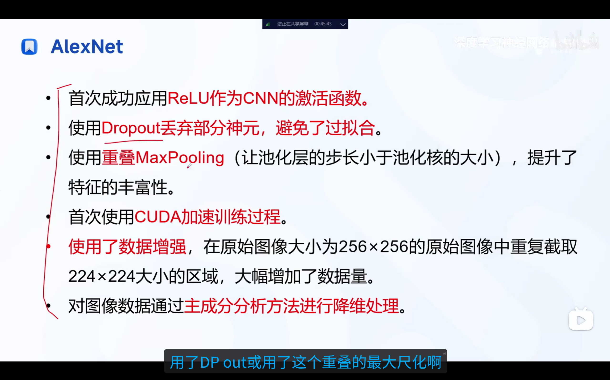

总共分成了八层，其中五个卷积层和三个全连接层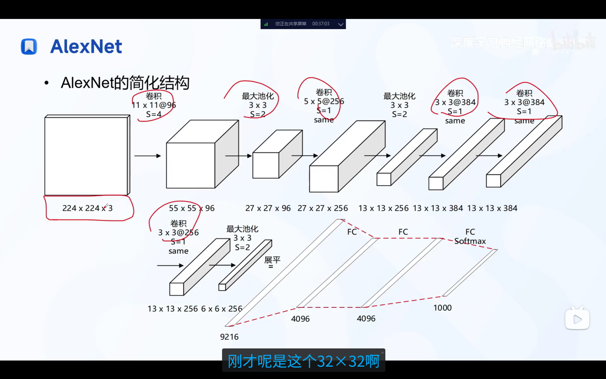
[^1]:实际计算输入层是227\*227\*3的RGB图像。

结构剖析：其中卷积层1、2、5含池化，3、4不含：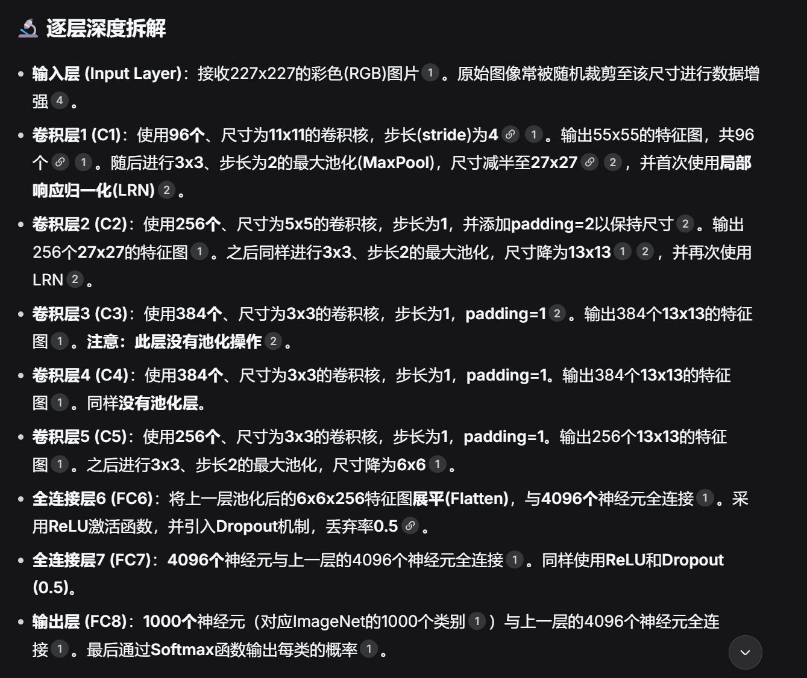

参数量的计算：==卷积层总参数量 = (卷积核高 \* 卷积核宽 \* 输入通道数 + 1) \* 卷积核个数==
<mark style="background-color: #165dff; color: #ffffff;">全连接层参数量 = 输出神经元个数 * (输入神经元个数 + 1)</mark>

弊端：全连接层参数量太大，导致计算量大；卷积核尺寸太多样，网络结构不规整。
### VGGNet：
解决了AlexNet卷积核尺寸不统一导致网络结构不规整的问题，所有卷积层使用3 \* 3、Padding = 1，所有池化层使用2 \* 2、Padding = 2。缺点是参数量太大。
 图像表示：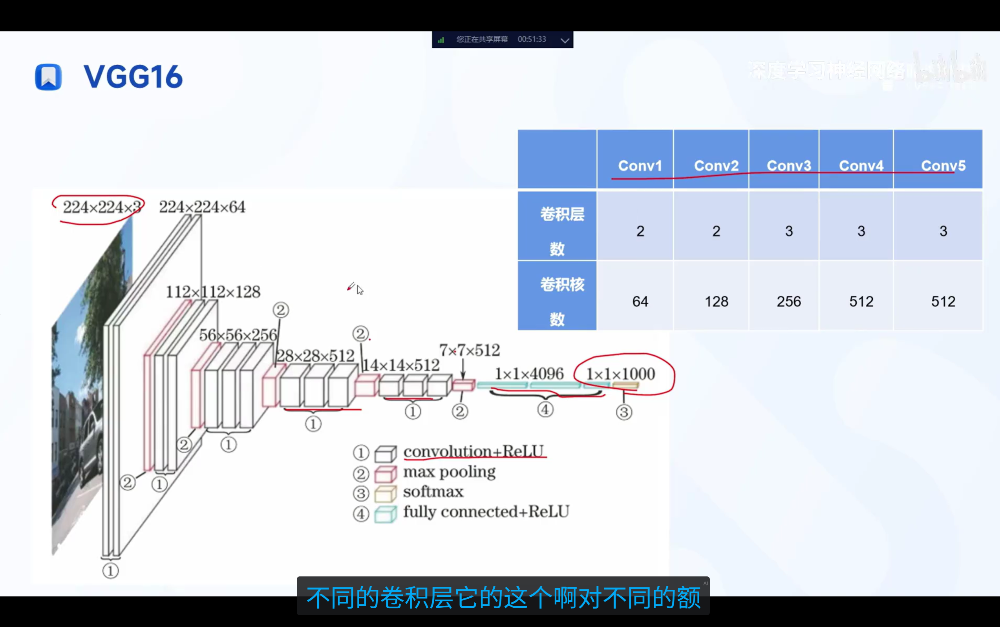
不同深度的网络配置：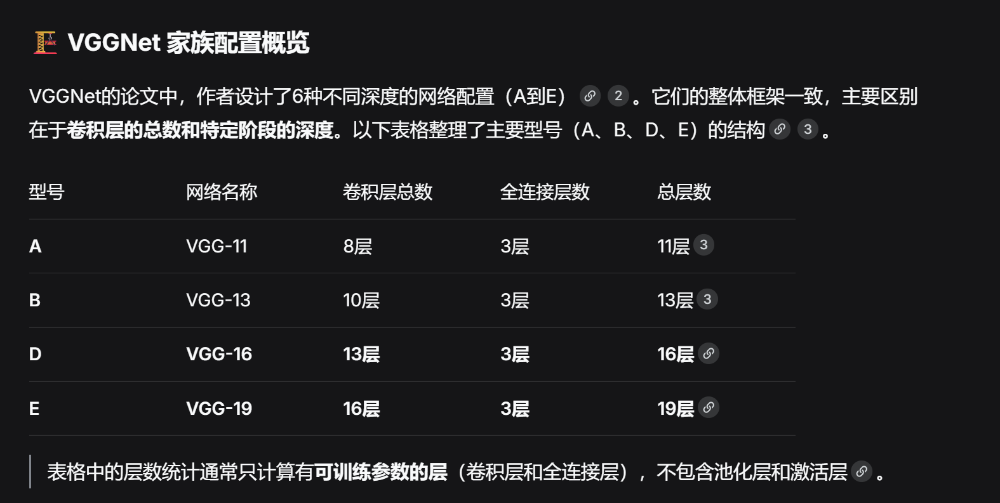
结构分析：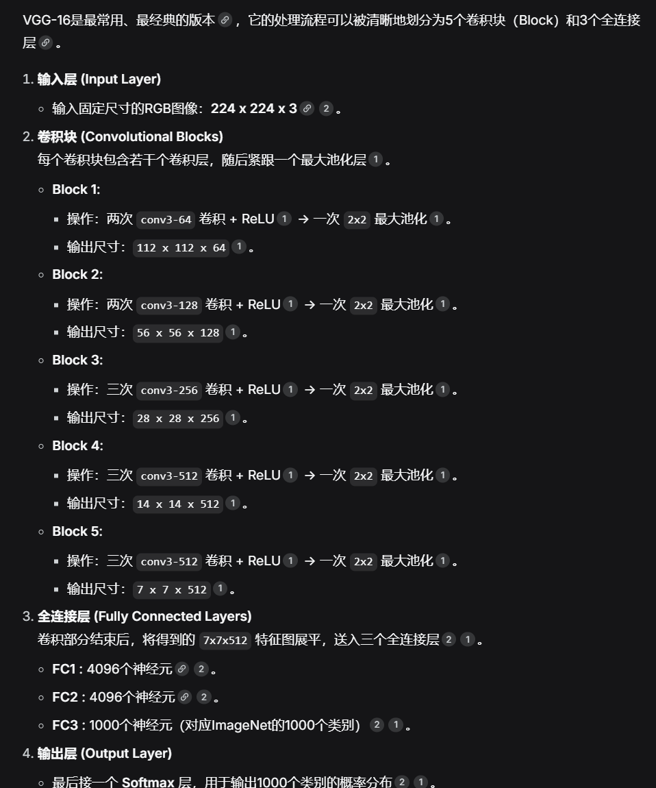
经过池化层后尺寸下降一倍，最后把7 \* 7 \* 512的特征图展平，与1 \* 1 \* 4096个神经元全连接。

### 残差网络ResNet
[学习视频](https://www.bilibili.com/video/BV1WUUaBSEzx?spm_id_from=333.788.videopod.sections&vd_source=2d9cc4fb5733e923eee8f59b3bd569d5)
$$\mathcal{H}(x) = \mathcal{F}(x) + x$$
其中$\mathcal{F}(x)$代表了对x进行卷积、批归一化、激活、再卷积、批归一化等操作，整体输出$\mathcal{H}(x)$就是x进行了一系列操作之后再加上x自己，然后再对$\mathcal{H}(x)$进行激活。
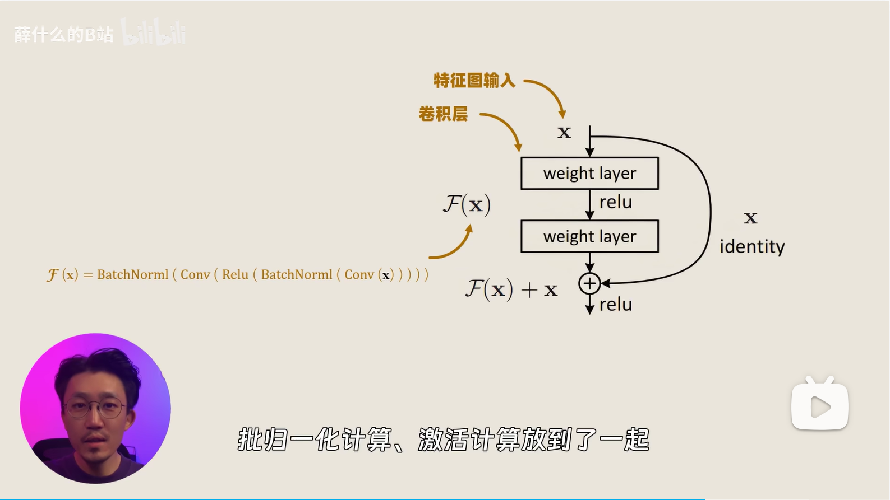
**缓解退化问题**：
   - 前向传播：当某一层学得足够好时，新加的层理论上应该实现恒等映射，而普通网络中让权重层学$\mathcal{H}(x)$是困难的，而残差网络中，只需要让新加的层学习$\mathcal{F}(x)=\mathcal{H}(x)-x=0$就可以了（将权重层参数全部设为零）。
   - 反向传播：对于残差块，对输入x的偏导数为$\frac{\partial L}{\partial x} = \frac{\partial L}{\partial y} \cdot \frac{\partial y}{\partial x} = \frac{\partial L}{\partial y} \cdot \left( 1 + \frac{\partial \mathcal{F}(x, W)}{\partial x} \right)$，化简后为$$\frac{\partial L}{\partial x} = \underbrace{\frac{\partial L}{\partial y}}_{\text{直接传递}} + \underbrace{\frac{\partial L}{\partial y} \cdot \frac{\partial \mathcal{F}}{\partial x}}_{\text{经过权重层传递}}$$传回浅层后，永远有个“+1”的常数项，解决了梯度消失的问题
   - 信息冗余与特征复用：残差网络允许浅层的原始特征x直接传递到深层，不必重头学习特征，只需要加上微小扰动$\mathcal{F}(x)$就行。

### VGGNet分析
[代码](./cats_dogs_task/VGGNet.ipynb)，深层L2矩阵的列数和浅层的列数一样，但是深层的行数明显多得多。    
因为输出是个矩阵，来看一下分布的起伏程度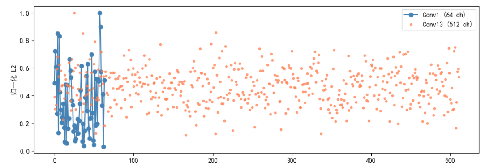可以看到浅层剧烈起伏，深层相对平坦。这是由于浅层网络分析的特征差别很大，所以向量长度差距很大，而深层分析的特征多多少少有点联系，差不了多少

### ResNet学习
ResNet利用直接传x，很好地解决了网络退化问题
##### basic block
用于ResNet-18/34
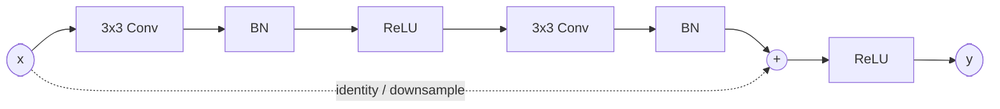
##### bottleneck
用于ResNet-50/101/152，思想跟basicblock是一样的，就是内部的结构不同
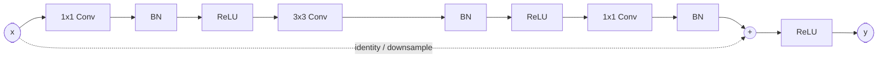
##### 替换实验
[给Conv4替换成Bottleneck](./cats_dogs_task/接入Bottleneck.ipynb)虽然卷积层参数下降了，但是整体的训练速度没感觉有多大变化，最终验证精度有0.01的微小提升（其它参数都保持不变的情况下），应该是设置的网络太浅了，如果加深一点对比应该会更明显。

### 网络结构实现
在猫狗分类器任务中的就是仿照AlexNet搭建的一个网络，网络的形状在学习AlexNet的笔记中也给出了