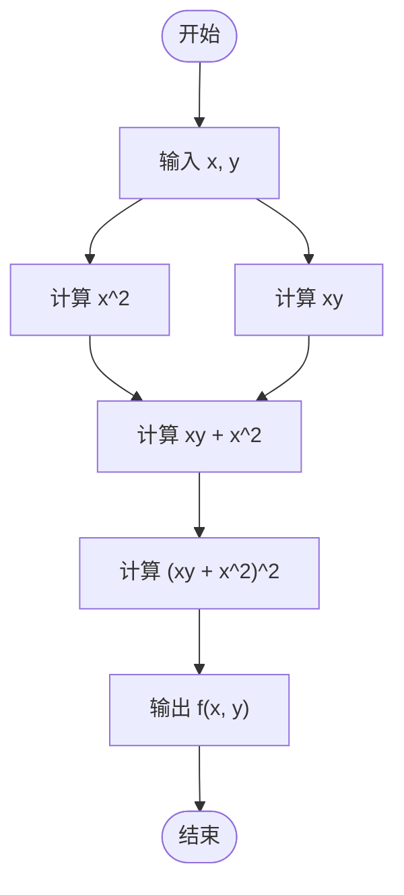
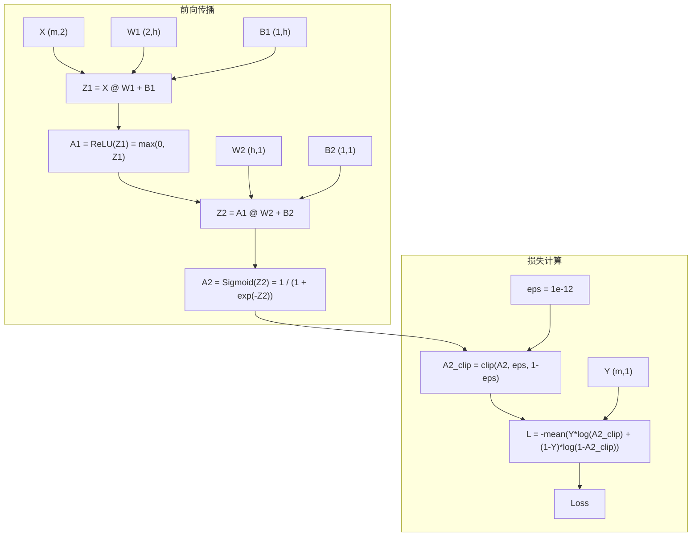

# loss.backward()
> loss.backward()的学习
## 实践1：简单计算链
1. 计算图：     

2. 代码：     
```python
import numpy as np

def MyBackward(x, y):
    x = np.asarray(x, float)
    y = np.asarray(x, float) # 先确保为数组

    a = x*y
    b = x*x
    c = a+b
    f = c*c

    df_dc = 2*c
    dc_da = 1
    dc_db = 1
    da_dx = y
    da_dy = x
    db_dx = 2*x

    df_dx = df_dc*dc_da*da_dx + df_dc*dc_db*db_dx
    df_dy = df_dc*dc_da*da_dy
    return df_dx, df_dy
```
详见[梯度计算_1.py](./梯度计算_1.py)

---

## 实践2：神经网络的梯度
代码见[神经网络的梯度_2.ipynb](./神经网络的梯度_2.ipynb)
1. 使用torch.random.randn()初始化线性层的权重，使用torch.zeros()初始化线性层的偏置，并且设置了随机种子方便复现，numpy版本和torch版本用的同一套
2. 

3. 参数设置完全一样，最大误差都在e-10以下，非常小了，说明numpy计算没有问题，而且对于Loss的计算，numpy甚至比autograd还多一位。可以一键跑一遍[神经网路的梯度_2](./神经网络的梯度_2.ipynb)，计算非常快。使用的是5的batch，然后形状什么的都使用print输出在代码里了。这里简单给一下：   
- 首要说明：batch为batchsize，Cin为输入，Netron为神经元数量，Cout为输出 
- X:(batch, Cin)
- Y:(batch,)或者(batch, 1)，取决于有没有reshape
- W1:(Cin, Netron)
- B1:(1, Netron)，第0维会自动广播
- Z1:(batch, Netron)
- A1:(batch, Netron)
- W2:(Netron, Cout)
- B2:(1, Cout)
- Z2:(batch, Cout)
- A2:(batch, Cout)    
换batch的话模型参数是不会变的，变的是X Y Z1 A1 Z2 A2这些
---
## 趁热打铁
1. 保存每一层的输入输出的原因：计算梯度时，最终的梯度是由各层与该参数相关的梯度累乘得到的，具体可以使用递归树来说明，比如说这个例子，$f(x, y) = x*y + x^2$，令u=x*y，v=x^2，要算f关于x的梯度就要把df_du和du_dx乘起来，再加上df_dv和dv_dx的积，所以要用到这些中间值。前向传播保存的那些中间激活，必须放在显存里，而且一直占到反向传播用完为止。
2. 从某个模型参数第一次出现的节点出发，一直向下沿伸，把该节点下所有分支都用红色表示出来，然后从红色分支的叶子节点反推回原节点，计算同一分支上相邻两个节点的偏导数，然后同一分支上的偏导数相乘，**最后**不同分支求得的结果相加得到损失关于该模型参数的偏导数。例如df_dw1 = (路径1的连乘) + (路径2的连乘) + ...
3. 二元交叉熵和Sigmoid配合后，会变成∂L/∂Z = (σ(Z) - Y) / m。没有依赖预测值的除法、梯度有界、不需要额外保存中间变量、计算量小
4. 先看一下Loss是不是算的一样，如果一样，就分析差异的形状：如果两边形状不同，大概率是广播、转置出了问题；如果形状相同但是数值差距大，可能是求平均的方式不同；如果只有部分行/列异常，那就也是广播、转置的问题；如果形状相同，但是整体对不上，那就是公式出了问题。
5. 帮我们根据L的值，以及前向传播的形状，计算了各个模型参数的梯度，然后保存在模型参数的属性中，例如w1.grad。
6. 一开始看到Loss超过了1有点不理解，因为之前的训练中Loss一般都是直接从小于1的地方开始减小，以为它的取值范围是[0, 1]。但是后来查询了知道，Loss的范围可以是$[0, +\infty]$。这是由数学公式决定的。在使用numpy计算损失时，没有对y进行reshape，导致Y以形状(5, )参加的二元交叉熵损失计算，自动广播出错然后输出的

---

## 拓展
见[神经网络的梯度_2](./神经网络的梯度_2.ipynb)的“训练”部分，make_moons属于一个简单的数据集，所以即使是最简单的SGD(w -= lr*w的梯度)，也能达到很高的精度，而且取了10000条数据，设置200个epoch，也能在一分钟内跑完。