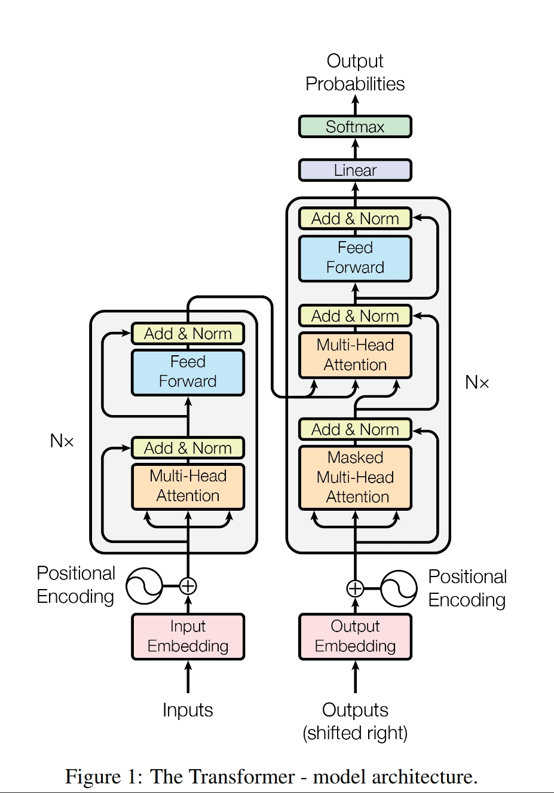
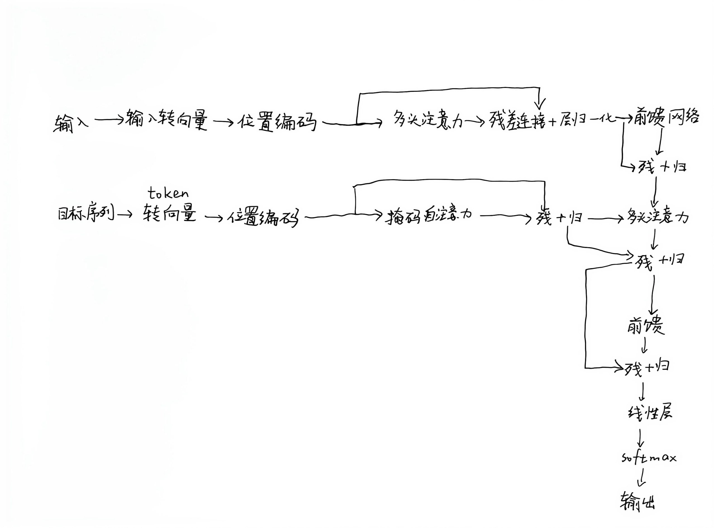
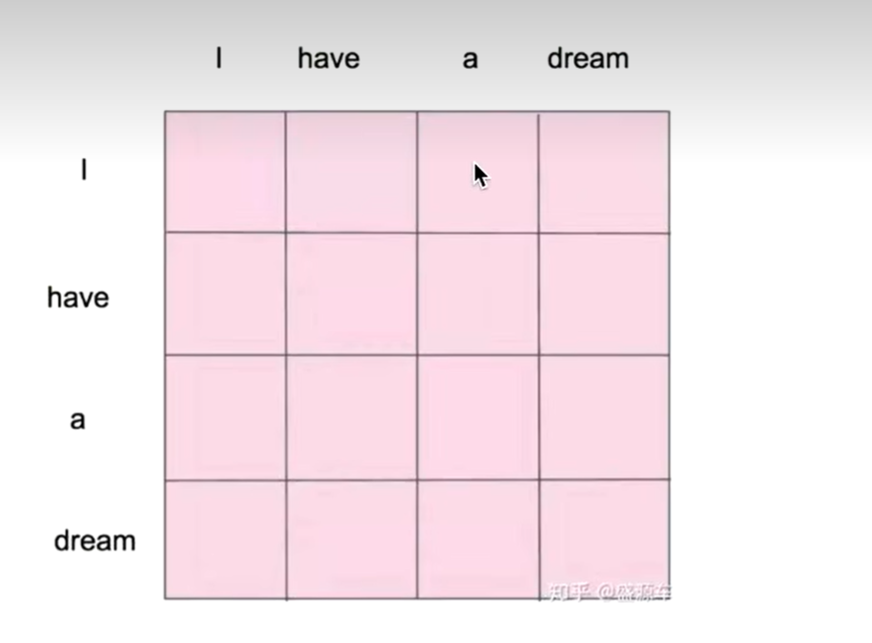
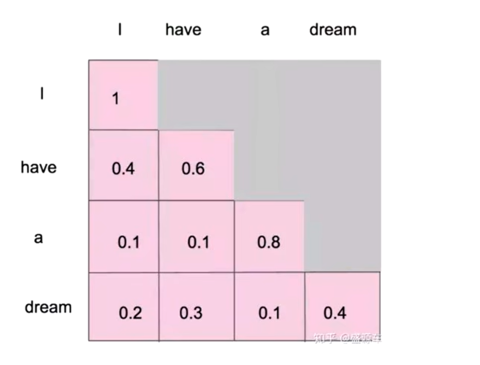

# Attention is All You Need
[论文链接](https://arxiv.org/abs/1706.03762)
[论文学习视频](https://www.bilibili.com/video/BV1dyW9zsEk1/?share_source=copy_web&vd_source=f39c1f30d2954fc0785b71603f8726ee)
[注意力机制学习视频](https://www.bilibili.com/video/BV16f1mB7Ebj/?share_source=copy_web&vd_source=f39c1f30d2954fc0785b71603f8726ee)

## 任务
---
1. 找出编码器和解码器：编码器就是原图的左边，一个多头注意力机制加一个前馈网络组成（还加入了残差连接。）（总共堆了六个这样的结构，原图为了简洁，只画了一个，然后用Nx来表示重复）；解码器是原图右边，在编码器的基础上加了一个掩码多头注意力机制，也是总共堆了六个这样的结构（解码器的每个重复块中，多头注意力层都要引入编码器输出的memory）。手绘图画在原图下边了，这样一画发现原图还是简单的，很难再简化了。并且我发现，那个掩码注意力层的机制就和掩码自注意力机制差不多，但是原文写的是Masked Multi-Head Attention，可能是加了Mask的缘故，然后解码器的第一层应该也是自注意力机制，编码器第二层是交叉注意力。    

-----------------

2. 论文第三节主要阐述了架构中一些机制，其中：    
>Scaled Dot-Product Attention：  
- 缩放点积注意力：公式为$$\text{Attention}(Q, K, V) = \text{softmax}\left( \frac{Q K^\top}{\sqrt{d_k}} \right) V
$$和普通的点击注意力公式相差就是除以的那个$\sqrt{d_k}$，因为作者说当$d_k$较大时，the dot products grow large in magnitude（这里翻译得不准确，所以用一下原文），从而将softmax推入梯度极小的区域，所以除以$\sqrt{d_k}$。虽然加性注意力和点积注意力复杂度差不多，但是点积是much faster and more space-efficient in practice，更快并且空间利用高效，所以这里用的点积。     

> Multi-Head Attention：
- 多头注意力：假设$d_{model}$是512，我们设置头的数量是8（h=8），就把512分成了8个64维，每个头64维，然后每个头有独属于各自的$W_q W_k W_v$。对每个头分别进行缩放点积，最后把八个头的输出从64维拼接(Concat)到512维，再交给$W^O$融合     
$$\text{MultiHead}(Q, K, V) = \text{Concat}(\text{head}_1, ..., \text{head}_h) W^O \\
\text{where } \text{head}_i = \text{Attention}(Q W_i^Q, K W_i^K, V W_i^V)
$$        
$$W_i^Q \in \mathbb{R}^{d_{\text{model}} \times d_k},\ W_i^K \in \mathbb{R}^{d_{\text{model}} \times d_k},\ W_i^V \in \mathbb{R}^{d_{\text{model}} \times d_v} \\
\text{and } W^O \in \mathbb{R}^{h d_v \times d_{\text{model}}}
$$
>Position-wise Feed-Forward Networks：
- 位置式前馈网络：简单来说就是线性层+ReLU+线性层，虽然线性层是相同的，但是不同位置用的参数不同$$\text{FFN}(x) = \max(0, x W_1 + b_1) W_2 + b_2
$$
>Positional Encoding：
- 位置编码：用向量来表示这个token的位置，有多少个token，就有多少个位置编码，位置编码向量的长度等于$d_{model}$。位置编码的每个维度对应于正弦曲线，选择这个函数是因为我们假设它可以让模型轻松学习关注相对位置。

3.     
 - 翻译工具：edge侧边翻译插件（谷歌翻译）、网易有道词典、蓝色大肥鱼（有些机翻不准的地方问的deepseek，然后定义理解那些问ds还是不如去b站了解）；     
 - 遇到不懂的地方：搞不懂$W^O$是干嘛的，它的维度的含义。后面问了d老师，知道了它的作用就是把Concat过后的输出加权求和。比如说512维的单个token，拆分成8个头处理，Concat过后输出1\*512的向量，而$W^O$是512\*512的，它的每一列分别乘以Concat输出，最后得到1\*512的输出。$W^O$的每一列，对应一个输出维度。这一列的每个参数，分别表示 Concat 结果中对应元素对“这个输出维度”的影响力。不同列参数不同，所以不同输出维度会从 Concat 结果中提取不同的组合模式。

4. 这篇论文最初的任务应该是机器翻译，从论文中WMT翻译任务可以看出。不用RNN或CNN的原因是作者刻意摒弃了recurrence和convolution，而且RNN尽管有LSTM和循环网络，RNN还是存在长期依赖和梯度消失问题，然后CNN的问题是局部感受野和长距离依赖路径长，

5. self指：Q、K、V同源，而普通的attention可能Q来自decoder，K和V来自encoder的输出

6. 对于自注意力机制，Q、K、V均来自于输入X，X分别乘以不同的矩阵$W_Q W_K W_V$得到Q、K、V；对于注意力机制，Q一般来源于$X_{decoder}$，而K和V来自于$X_{encoder}$。经过不同的线性变换的原因是QKV功能不同：      
- Query：当前位置在找什么信息；
- Key：每个位置能提供什么被匹配的特征；
- Value：每个位置真正要被聚合的内容。

7. 经过softmax的原因：$QK^T$得到的分数可以是任意实数，经过softmax把任意实数变成归一化权重、让注意力变成软选择、可微。注意力权重矩阵的每一行对应一个Query，每一列对应一个Key，$A_{ij}$表示第i个位置在更新自己的表示的时候，对第j个位置的关注程度。

8. 多头注意力不是把一件事重复多次。把某个向量的所有维度均分为h个头处理，每个头都有自己的$W_QW_KW_V$，每个头分别进行缩放点积，最后再Concat起来。能让模型**在多个子空间里学习不同关系**，并且每个头可以关注不同位置，而且计算量还是和单头的一样。
9. 没有循环结构：Output shifted right 负责“给解码器提供输入”；Masked Multi-Head Attention 负责“不让解码器偷看未来”。两者一起，保证解码器在每个位置只能根据前面的词预测下一个词。  
  Output shifted right 让输入整体右移，并在前面补<BOS>，例如I love you <EOS>变成了<BOS> I love you，由于解码器是自回归的，所以第一个位置有\<BOS\>，只能预测I，第二个位置有\<BOS\> I，只能预测love，第三个位置有\<BOS\> I love，只能预测you，第四个位置预测\<EOS\>。    
  而右移只解决了“输入里没有当前词”，并没有解决“自注意力会让位置 1 看到位置 2、3、4 的信息”。所以必须再加 mask。例子中的四个位置一起送进掩码自注意力，让位置1只能看位置1，位置2只能看位置1、2，以此类推。
10. mask的作用在第九点说过了，就是处于某个位置只能往前看的机制。
没有掩码是这样的：

有掩码是这样的：
如果提前看了，那么e.g.狗追猫就可能变成猫追狗 ，语序变得混乱了。
11. 残差链接在每一层末尾都有一次，和norm层归一化一起出现，而前馈网络在每一个结构的末尾出现一次；    
- 残差的作用：类似于残差网络，梯度可以通过恒等路径直接回传，并且可以帮助把位置信息和底层语义传到深层
- 前馈网络：引入非线性变换、对每个token做特征提取和变换。

--- 

## 拓展
1.2. 见[缩放点积注意力.ipynb](./缩放点积注意力.ipynb)
3. DiT：DiT的输入是一个带噪声的潜在表示（Noisy Latent），外加扩散时间步（Timestep）和条件信息（如类别标签或文本）。与U-Net依赖卷积核的局部感受野不同，DiT中的每个Patch Token都可以通过自注意力机制，直接“看到”序列中的所有其他Patch。对比原版，DiT做出了一个关键的修改：adaLN-Zero，它让条件信息以一种非常高效的方式注入网络：条件向量被用来预测每个Transformer块中LayerNorm的缩放（scale）和偏移（shift）参数，并且初始时这些参数被设为零，使得网络在训练初期表现得像一个恒等映射，从而保证了深度Transformer训练的稳定性。
4. 
### Encoder only：
>BERT
- BERT 的核心由多层Transformer Encoder堆叠而成，其输入是经过WordPiece分词和位置编码的文本序列。
- 训练目标：掩码语言模型、下一句预测
- 适用任务：极其擅长判别式任务，即从已有文本中提取信息或做出判断，而非创造新文本。

### Decoder only
>GPT
- GPT由多层Transformer Decoder堆叠而成，其关键机制是掩码自注意力（Masked Self-Attention），它通过一个“因果掩码”强制模型在预测时只能依赖已生成的上文。
- 训练目标：预测下一个token
- 适用任务：生成式任务例如文本生成和续写、对话、代码生成和工具调用